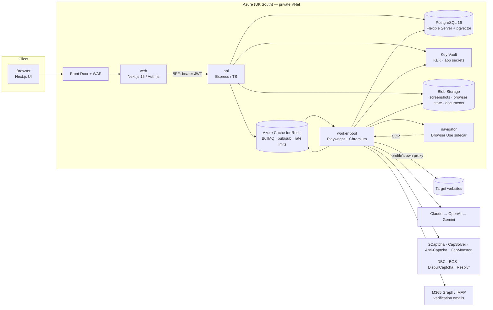
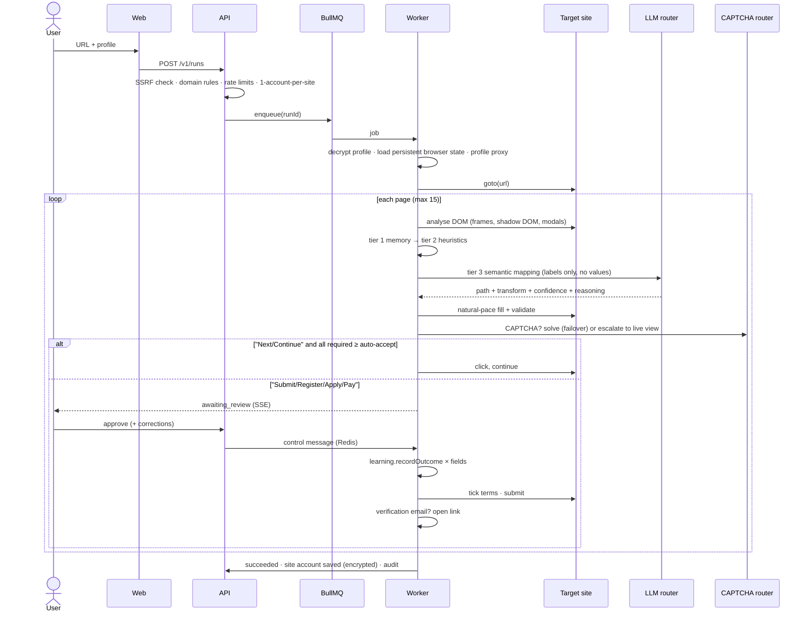
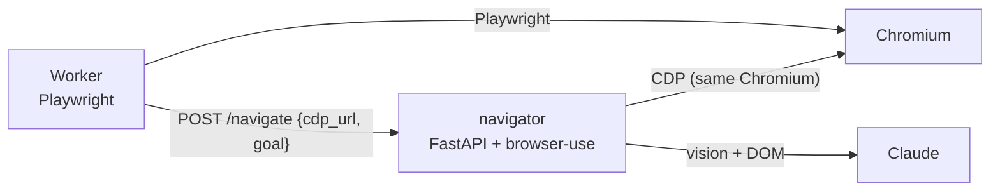
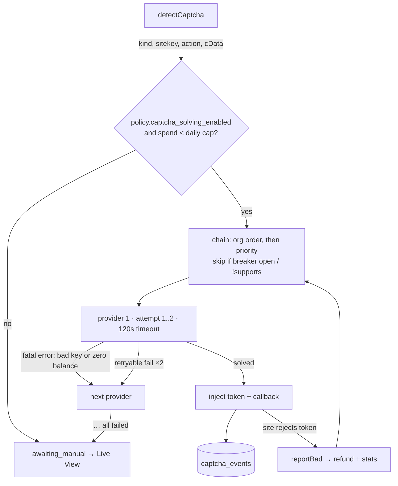
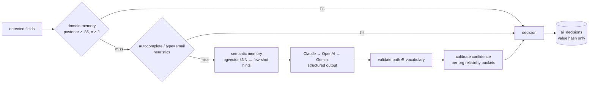
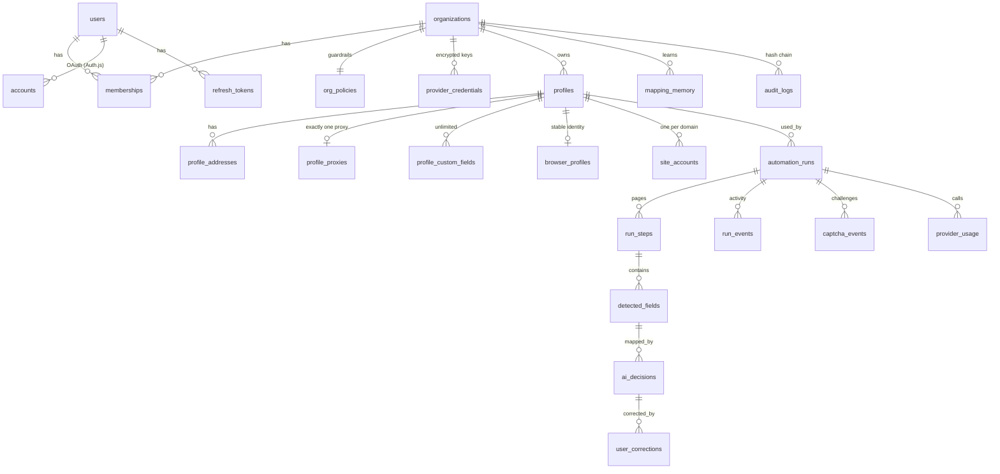

# Architecture

Covers deliverables 1–3 and 6–12: product architecture, technical diagrams, database design, folder structures, the Browser Use, Playwright, CAPTCHA and AI mapping architectures, and the learning system.

---

## 1. Product architecture

| Capability | What the user experiences | Where it lives |
|---|---|---|
| **Profiles** | Enter details once. Unlimited profiles and unlimited custom fields. One proxy per profile. | `profiles*` tables · `services/profiles` · `/profiles` UI |
| **Run an automation** | Paste a URL, pick a profile and click Start. | `POST /v1/runs` → BullMQ → worker |
| **Agent** | Opens the site, finds the form (following "Sign up" links if needed), maps and fills fields, handles CAPTCHAs, and moves through multi-step flows. | `automation/runOrchestrator.ts` |
| **Review & approve** | Screenshot plus a table showing each field's value, confidence and reasoning. Fix anything, then approve. | `/runs/[id]` · `POST /v1/runs/:id/approve` |
| **Learning** | Every approval or correction trains the next run. Fields seen before skip the LLM entirely. | `services/learning` |
| **Admin** | Encrypted API keys with failover order, connection test and rotation. Policy guardrails. Audit log. | `/admin/*` |
| **Dashboard** | KPIs, runs, CAPTCHA performance, AI accuracy, learning trend, provider usage and status. | `GET /v1/analytics/dashboard` |

**How the 80% time saving is reached.** A typical 25-field registration takes a person 4–6 minutes: about 9 s per field to look up, type and check, plus navigation. The agent fills it in 40–90 s. The reviewer then spends 20–40 s on the review screen, which shows only the flagged fields. The dashboard's *Time saved* tile measures this on real runs: agent minutes against a 9 s/field manual benchmark.

---

## 2. Technical architecture



**Process split**

| Process | Image | Scales on | Why separate |
|---|---|---|---|
| `web` | distroless Node | HTTP RPS | Public edge; holds only the session cookie |
| `api` | distroless Node | CPU | Stateless; never launches browsers |
| `worker` | Playwright noble | BullMQ backlog (KEDA) | Heavy (≈1 vCPU + 1 GB per browser); can hold a browser open while waiting for review |
| `navigator` | Python 3.12 | CPU | Browser Use is Python; navigation only (never fills or submits) |

---

## 3. Agent workflow (end to end)



**Run states:** `queued → launching → analysing → mapping → filling → solving_captcha | awaiting_manual → awaiting_review → submitting → succeeded | failed | cancelled | paused`.

**Resumability.** After every step, `automation_runs.checkpoint` stores `{url, step, review}` and cookies are saved to Blob. If a pod is evicted, BullMQ retries and the run continues from the checkpoint. If a reviewer is away for more than 20 min, the run moves to `paused` and **Resume** picks it up again. Learned mappings make the re-fill take seconds.

---

## 4. Playwright architecture (`apps/api/src/automation/`)

| Module | Responsibility |
|---|---|
| `browserSession.ts` | One **stable identity per profile**: fixed UA, viewport, locale and timezone stored in `browser_profiles`. Traffic always goes out through the profile's single proxy. `storageState` (cookies + localStorage) is encrypted to Blob after each run, so logins and half-finished applications persist. Runs on local Chromium, or remotely through `BROWSER_WS_ENDPOINT` (Browserless/Browserbase). |
| `pageAnalyzer.ts` | Self-contained in-page extractor run in **every frame**. It walks open shadow roots and records whether each field sits inside a dialog. It resolves labels from `<label for>`, wrapping labels, `aria-labelledby`, `aria-label`, placeholder, legends and nearby text. It detects honeypots, radio groups and select options, step indicators ("Step 2 of 5"), and sign-up links. It produces a **stable `field_key`** = sha256(domain, frame, form index, name, id, label, kind) for learning. |
| `formFiller.ts` | Kind-specific filling: select (value then label), radio, checkbox, file (decrypt from Blob to temp), native date (ISO), combobox (type then pick option), text (natural typing). After filling, it reads back `checkValidity()`, `aria-invalid` and nearby error text. |
| `humanInput.ts` | Bézier mouse paths, log-normal key timing and blur after typing. Key-by-key input is what makes React/Vue controlled inputs and input masks register the value. |
| `transforms.ts` | `date:DD/MM/YYYY`, `phone:e164|national`, `country:name|alpha2`, `split:first|last`, `option:<v>`. |
| `navigator.ts` | Classifies buttons as **ADVANCE** (Next/Continue, may auto-click) or **COMMIT** (Submit/Register/Apply/Pay, which always needs approval). Also handles cookie banners and sign-up links, and calls the Browser Use sidecar as a fallback. |
| `captchaDetector.ts` | Detects every supported CAPTCHA type, captures the challenge, injects the token and fires `data-callback`. |
| `liveView.ts` | CDP screencast to Redis to SSE to ``. Clicks and keys are replayed into the page. Used when a CAPTCHA or an unknown page needs a person. |
| `runOrchestrator.ts` | The state machine, the review gate, the control channel (`run:<id>:control`), checkpoints, email verification and site-account storage. |

---

## 5. Browser Use architecture (`apps/navigator/`)



* **When it is used:** the deterministic path found no form and no obvious sign-up link. Examples are mega-menus, "Choose account type" interstitials and SPA routers.
* **Hard limits (in its system prompt):** it does not type, does not tick boxes and does not submit. It stops when the form is visible. All PII stays in the Node worker.
* **Why it is a sidecar:** Browser Use is Python. Attaching over CDP to the *same* browser keeps cookies, the proxy and the identity consistent.

---

## 6. CAPTCHA handling architecture (`services/captcha/`)



| Type | Detection | Providers |
|---|---|---|
| reCAPTCHA v2 / invisible / Enterprise | `.g-recaptcha`, anchor iframe `k=`, `size=invisible` | all |
| reCAPTCHA v3 | `api.js?render=<key>` + action scraped from inline script | all except slider-only |
| hCaptcha | `.h-captcha`, hcaptcha iframe | 2Captcha, Anti-Captcha, CapMonster, DBC, BCS |
| Cloudflare Turnstile | `.cf-turnstile`, challenges iframe | all |
| Image | captcha input + adjacent ``/`<canvas>` (screenshot → base64) | all |
| Slider | GeeTest/Tencent/"slide to verify" containers | Live view (reviewer) |

* **Adapters:** `createTaskApi.ts` covers 2Captcha (api v2), Anti-Captcha and CapMonster through one shared protocol. The same adapter also serves **DispurCaptcha**, **Resolvr** and any "compatible" service once an admin sets the base URL from that provider's docs. **CapSolver** (`capsolver.ts`), **DeathByCaptcha** and **BestCaptchaSolver** have their own adapters.
* **Same IP:** when the profile has a proxy, it is passed to the solver (proxy task types), so the token is minted from the IP the browser uses.
* **Metrics:** `captcha_events` holds one row per attempt. The `captcha_provider_stats` materialised view (refreshed every 15 min) gives success rate, failure rate, average solve time and cost per solve per provider and type.
* **Circuit breaker:** 5 failures in 10 min opens the breaker for 5 min, and that provider is skipped.

---

## 7. AI mapping architecture (`services/ai/`)



* **Values never go to the LLM.** The model sees field metadata plus the profile's *vocabulary*: slot paths, labels, types and synonyms, with an `EMPTY` flag for slots that have no value. Values are substituted inside the worker.
* **Structured output:** Claude uses `messages.parse` + `zodOutputFormat`, OpenAI uses `chat.completions.parse` + `zodResponseFormat`, and Gemini uses `responseJsonSchema`. All three validate against the same `MappingSchema`.
* **Output per field:** `profilePath | null`, `transform`, `confidence`, one-line `reasoning`. Per page: `pageKind`, `submitLocatorHint`.
* **Failover:** org order (default Claude → OpenAI → Gemini) with a Redis circuit breaker (3 failures, open 60 s). A Claude refusal is treated as a failure and fails over. Every attempt is logged to `provider_usage`.
* **Cost control:** effort `low` on Claude, prompt caching on the vocabulary system prompt, and tiers 1–2 skip the LLM. In steady state on repeat sites, most fields never reach the LLM.
* **Completion confidence** = (required coverage)² × mean confidence of mapped fields. A single unmapped required field pulls the score down hard, so the reviewer looks at it.

---

## 8. Learning system design (`services/learning/learningService.ts`)

Every field on an approved page produces a labelled example: *accepted*, *corrected*, *rejected*, *skipped* or *validation_failed*.

| Loop | Store | Update rule | Effect next run |
|---|---|---|---|
| **Domain memory** | `mapping_memory (scope=domain)` keyed by `field_key` | Beta(α, β): success → α+1; wrong proposal → β+1 | Posterior ≥ 0.85 with n ≥ 2 → answered from memory (no LLM, near-zero latency) |
| **Semantic memory** | `mapping_memory.embedding` (pgvector, HNSW) | Confirmed mapping is embedded (text-embedding-3-small when OpenAI is configured) | kNN neighbours injected as few-shot evidence for **new** sites |
| **Calibration** | `confidence_calibration` (0.50–0.95 buckets) | +1 prediction, +1 correct if accepted | Raw confidence blended toward observed accuracy once a bucket has 20+ samples |
| **Site playbooks** | `site_playbooks` | Step order and advance buttons per domain/flow | Faster multi-step navigation (Phase 2 consumer) |
| **Corrections log** | `user_corrections` | from/to path + transform | Offline eval set; prompt and heuristic tuning |

Dashboard metrics come from `v_learning_trend`: weekly acceptance %, and the % of decisions answered from memory. Both should rise over time.

---

## 9. Database design

The full DDL is in [`db/migrations/0001_init.sql`](../db/migrations/0001_init.sql). It is verified: it applies cleanly on PostgreSQL 16 + pgvector, RLS isolates tenants, and the audit-log hash chain links each row and blocks updates.



| Requirement group | Tables |
|---|---|
| Users: accounts, authentication, roles | `users`, `accounts`, `sessions`, `verification_tokens`, `refresh_tokens`, `memberships(role)` |
| Profiles: personal, address, proxy, custom | `profiles`, `profile_addresses`, `profile_proxies` (UNIQUE profile_id), `profile_custom_fields`, `browser_profiles`, `site_accounts`, `documents` |
| Automation history | `automation_runs` (URL, timestamps, result, generated `duration_ms`), `run_steps`, `run_events` |
| CAPTCHA analytics | `captcha_events`, `captcha_provider_stats` (MV: success/failure rate, cost per solve) |
| AI decisions | `detected_fields`, `ai_decisions`, `user_corrections`, `mapping_memory`, `confidence_calibration`, `site_playbooks` |
| Audit logs | `audit_logs` (append-only, hash-chained; logins, profile/API changes, submissions) |

Every `*_enc` column is an AES-256-GCM envelope produced by the application. The DB never sees plaintext PII or keys.

---

## 10. Folder structures

### Backend (`apps/api`)
```
apps/api/
├── src/
│   ├── index.ts                     # Express app: helmet, CORS, rate limits, routes
│   ├── worker-main.ts               # BullMQ worker process (automation + maintenance)
│   ├── config/env.ts                # zod-validated environment
│   ├── lib/                         # crypto (envelope AES-256-GCM, KEK), db (RLS tx), redis, blob, logger, errors
│   ├── middleware/                  # auth (JWT ES256), rbac (permission matrix), audit (hash chain), http
│   ├── routes/                      # auth, profiles, runs (+SSE, review, approve, manual), providers, analytics/policy/audit
│   ├── queue/queues.ts              # BullMQ queues + schedulers
│   ├── automation/                  # Playwright layer (see §4)
│   └── services/
│       ├── ai/                      # providers/{claude,openai,gemini}, router (failover), prompts, heuristics, mappingEngine
│       ├── captcha/                 # providers/{createTaskApi,capsolver,deathbycaptcha,bestcaptchasolver}, captchaRouter
│       ├── learning/                # memory, semantic hints, calibration, outcome recording
│       ├── profiles/                # encrypted CRUD, vocabulary/flattening
│       ├── secrets/                 # provider credential vault, failover chains, rotation
│       ├── policy/                  # SSRF guard, domain rules, rate/concurrency caps, 1-account rule
│       ├── email/                   # verification inbox (Graph / IMAP)
│       └── auth/                    # token issue/rotation/reuse detection
└── test/                            # vitest
```

### Frontend (`apps/web`)
```
apps/web/src/
├── auth.ts                          # Auth.js v5: Entra ID, Google, credentials+TOTP; API token exchange/refresh
├── middleware.ts                    # session required everywhere except /login
├── lib/{api.ts, utils.ts}           # server-side API client (bearer), client fetch helpers
├── components/ui/                   # shadcn/ui primitives
└── app/
    ├── login/                       # sign-in
    ├── api/auth/[...nextauth]/      # Auth.js handlers
    ├── api/v1/[...path]/            # BFF proxy (adds bearer; streams JSON, PNG, SSE)
    └── (app)/
        ├── dashboard/               # KPIs + charts
        ├── profiles/ · profiles/[id]/ProfileForm.tsx
        ├── runs/ · runs/new/ · runs/[id]/RunConsole.tsx  (activity, review, live view)
        └── admin/{api-keys, policy, audit}/
```
