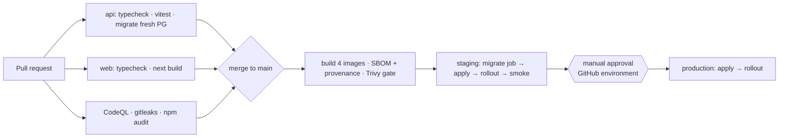

# Deployment: Azure, Docker, Kubernetes, CI/CD, costs

Covers deliverables 16–19 and 22.

## Azure deployment architecture

```mermaid
flowchart TB
  U((Users)) --> FD[Azure Front Door Premium + WAF]
  FD -->|Private Link| AGIC[AKS ingress (NGINX / AGC)]
  subgraph RG["rg-formagent-prod (UK South, zone-redundant)"]
    subgraph VNET["vnet 10.40.0.0/16"]
      subgraph AKS["AKS (Azure CNI Overlay, Workload Identity, KEDA, CSI Secrets)"]
        SYS[system pool<br/>2× D2s_v5]
        APP[app pool<br/>web · api · navigator<br/>3× D4s_v5 autoscale]
        BRW[browsers pool (tainted)<br/>workers<br/>2–30× D4s_v5 autoscale<br/>spot optional]
      end
      PE[private endpoints subnet]
    end
    PG[(PostgreSQL Flexible Server<br/>GP D4ds_v5, zone-redundant HA,<br/>pgvector, PITR 35 d)]
    REDIS[(Azure Cache for Redis<br/>Standard C2 / Premium P1)]
    BLOB[(Storage Account ZRS<br/>containers: run-artifacts, browser-state, documents<br/>lifecycle: artifacts → cool 30 d → delete 180 d)]
    KV[Key Vault Premium (HSM)]
    ACR[Container Registry Premium]
    LA[Log Analytics + App Insights + Sentinel]
    NAT[NAT Gateway<br/>static egress IP]
  end
  AGIC --> APP
  APP & BRW --> PE --> PG & REDIS & BLOB & KV
  BRW --> NAT --> Internet((Target sites / AI / CAPTCHA APIs))
```

**Provisioning:** Bicep or Terraform per environment (`dev`, `staging`, `prod`). Use separate subscriptions for staging and prod. Apply the Azure Policy initiatives *"Kubernetes cluster pod security restricted"* and *"Deny public network access"* on PaaS.

**Day-2 operations:**
* **Backups:** Postgres PITR (35 d) plus weekly long-term backup to vault. Blob soft-delete and versioning.
* **DR:** geo-restore Postgres to UK West. ACR geo-replication. RPO ≤ 1 h, RTO ≤ 4 h (Phase 2: warm standby).
* **Observability:** OpenTelemetry → App Insights. Alerts on run failure rate > 15 %/h, CAPTCHA success < 70 %, AI failover rate > 10 %, queue wait > 2 min, and an open circuit breaker on any provider.

## Docker configuration
| Image | File | Base | Notes |
|---|---|---|---|
| `formagent-api` | `infra/docker/api.Dockerfile` | distroless nodejs22, nonroot | No browser; ~120 MB |
| `formagent-worker` | `infra/docker/worker.Dockerfile` | `mcr.microsoft.com/playwright:v1.49.1-noble` | Version **must equal** the `playwright` npm pin; runs as `pwuser`; needs `/dev/shm` ≥ 1 GB |
| `formagent-web` | `infra/docker/web.Dockerfile` | distroless, Next.js `standalone` output | |
| `formagent-navigator` | `infra/docker/navigator.Dockerfile` | python:3.12-slim | browser-use pinned |

Local stack: `./scripts/dev-secrets.sh > .env && docker compose up --build`. It includes Postgres with pgvector (migrations auto-applied), Redis, api, worker, navigator and web.

## Kubernetes deployment recommendations
The manifests are in `infra/k8s/base.yaml`.

1. **Dedicated, tainted browser node pool.** Chromium is bursty and memory-hungry, so keep it away from the API. Plan for about 1 vCPU and 1–1.3 GB per concurrent browser. A D4s_v5 (4 vCPU / 16 GB) runs 3 workers at concurrency 3 ≈ **9 browsers**.
2. **Scale workers on queue depth, not CPU.** KEDA Redis scaler on `bull:automation-runs:wait` (3 jobs per replica). The cluster autoscaler adds nodes. A cooldown of 10 min avoids thrash.
3. **Graceful drain.** `terminationGracePeriodSeconds: 1500` and `Worker.close()` let in-flight runs reach a checkpoint. PDB `minAvailable: 1`. BullMQ `lockDuration` of 120 s plus stalled-job recovery resumes on another pod.
4. **Security context:** `runAsNonRoot`, `seccompProfile: RuntimeDefault`, `drop: [ALL]`, `readOnlyRootFilesystem` on api, and namespace `pod-security.kubernetes.io/enforce: restricted`.
5. **Secrets:** Key Vault through the Secrets Store CSI driver and **workload identity**. No Kubernetes secrets live in git, and there are no pod-identity keys.
6. **Network policy:** default-deny ingress. Workers may reach the internet but **not** RFC1918 or IMDS.
7. **Spot nodes for browsers (optional, about −60 %).** Safe because runs checkpoint and BullMQ retries. Keep at least 2 on-demand nodes.
8. **Hosted browsers instead of the browser pool:** set `BROWSER_WS_ENDPOINT` to Browserless/Browserbase and shrink the browser pool to near zero. This trades node cost for per-minute browser fees and native live-view URLs.

## CI/CD pipeline design (`.github/workflows/ci-cd.yml`)


* **Auth to Azure:** GitHub OIDC federated credential (`azure/login`). No client secrets.
* **Migrations:** run as a Kubernetes Job with a *migration* role that has DDL rights. The app role (`formagent_app`) has none. Migrations must be backward compatible (expand → migrate → contract) so a rolling deploy stays safe.
* **Rollback:** `kubectl rollout undo` (images are immutable, tagged by SHA). DB changes are forward-only.
* **Recommended additions:** Playwright E2E against a fixture site of sample forms (multi-step, iframe, shadow DOM, each CAPTCHA type in test mode), and an LLM mapping eval run nightly against the stored `user_corrections` set.

## Estimated infrastructure costs (monthly, UK South, pay-as-you-go list prices — planning estimates only)

These are rough planning figures. Check them in the Azure Pricing Calculator for your region and agreement. Reserved instances or savings plans typically cut compute by 30–50 %.

| Component | MVP (≈2k runs/mo) | Growth (≈50k runs/mo) |
|---|---|---|
| AKS nodes: system + app + browsers | 3× D4s_v5 ≈ £330 | 3 app + avg 8 browser D4s_v5 ≈ £1,200 (spot ≈ £700) |
| PostgreSQL Flexible (GP D2ds/D4ds, HA at growth) | ≈ £150 | ≈ £650 |
| Azure Cache for Redis (C1 → P1) | ≈ £75 | ≈ £330 |
| Storage (Blob ZRS, 100 GB → 1 TB) | ≈ £10 | ≈ £60 |
| Front Door Premium + WAF | ≈ £260 | ≈ £320 |
| Key Vault Premium, ACR, NAT, Log Analytics | ≈ £120 | ≈ £450 |
| **Azure subtotal** | **≈ £950** | **≈ £3,000** |
| AI tokens (Claude Opus 5.5 at low effort; ~4k in / 1k out per uncached page, ~3 pages/run, falling as memory hits rise) | ≈ £50–100 | ≈ £900–1,800 |
| CAPTCHA solving (≈30 % of runs hit one; ~$1–3 per 1,000 token solves) | < £5 | ≈ £30–60 |
| Optional hosted browsers (Browserless/Browserbase) instead of the browser pool | — | ≈ £500–1,500 |

**Unit economics:** at growth scale, about **£0.08–0.12 per completed run**. Compute dominates until memory hits push AI cost down.
