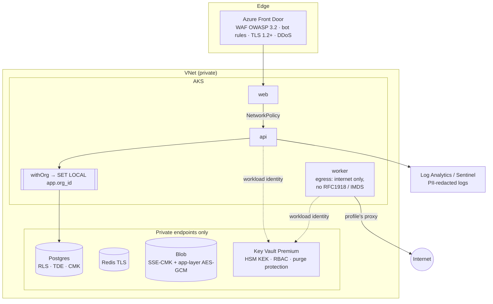

# Authentication & security architecture

Covers deliverables 14 and 15.

## Authentication architecture

```mermaid
sequenceDiagram
  actor U as User
  participant W as Next.js (Auth.js v5)
  participant IdP as Entra ID / Google
  participant A as API
  participant DB as Postgres

  U->>W: Sign in
  alt OAuth
    W->>IdP: OIDC (PKCE, state, nonce)
    IdP-->>W: id_token
  else Email + password (+TOTP)
    W->>A: POST /auth/verify-password (x-internal-secret)
    A->>DB: argon2id verify
  end
  W->>A: POST /auth/exchange {userId} (x-internal-secret, server-to-server)
  A->>DB: membership/role (create org + DEK on first login)
  A-->>W: access JWT (ES256, 15 min) + refresh (opaque, 14 d, rotating)
  W-->>U: encrypted httpOnly session cookie (holds tokens; JS can't read)
  U->>W: /api/v1/* (cookie)
  W->>A: Authorization: Bearer <JWT>
  A->>A: verify sig/iss/aud/exp → RBAC → withOrg(RLS)
  Note over W,A: Refresh is rotated on every use. Reuse of an old refresh token revokes the whole family.
```

| Control | Implementation |
|---|---|
| OAuth | Auth.js providers: Microsoft Entra ID (M365 tenants, supports conditional access/MFA upstream) and Google |
| Passwords | argon2id (64 MiB, t=3). A dummy hash is verified when the user is unknown, which prevents user enumeration. Failed attempts are audited |
| MFA | TOTP secret encrypted (`users.mfa_secret_enc`); enforced per org (Phase 2: WebAuthn passkeys) |
| JWT | ES256 asymmetric. The API holds the private key from Key Vault; other services verify with the public key only. Claims: `sub, org, role, sid, jti`. `kid` header for rotation |
| Sessions | Auth.js JWE cookie: `HttpOnly; Secure; SameSite=Lax`, 12 h. Refresh family per login (`refresh_tokens.family_id`). Logout revokes the family |
| Service-to-service | `INTERNAL_EXCHANGE_SECRET` (constant-time compare) on `/auth/exchange` and `/auth/verify-password`. These routes are blocked at the BFF. AKS NetworkPolicy only lets `web` reach `api` |

## Security architecture



### Encryption (AES-256)
```
Key Vault (RSA-HSM 3072 KEK, never exportable)
   └─ wrap/unwrap (RSA-OAEP-256) ─► per-organisation DEK (256-bit), stored wrapped in organizations.dek_wrapped
                                       └─ AES-256-GCM, 96-bit random IV, org_id as AAD
                                            ├─ profile PII columns (*_enc)
                                            ├─ proxy username/password
                                            ├─ provider API keys (provider_credentials.secret_enc)
                                            ├─ site-account credentials
                                            └─ Blob objects: screenshots, browser storageState, uploaded documents
```
* **AAD = org id.** A ciphertext copied into another tenant's row fails authentication.
* **Blind index** (`HMAC-SHA256`, separate key) supports email lookup without decrypting.
* **KEK rotation:** Key Vault creates a new version, then a job re-wraps the DEKs. The data does not need re-encrypting. To **rotate a DEK**, re-encrypt the org's rows in the background, using the `key_id` stored in each envelope.
* **Crypto-shredding:** deleting a profile nulls its ciphertext, and deleting an org destroys its wrapped DEK.
* **In transit:** TLS 1.2+ everywhere (Front Door → AKS ingress, private-endpoint TLS to PG/Redis/Blob).

### Role-based access control
| Permission | owner | admin | operator | reviewer | viewer |
|---|:-:|:-:|:-:|:-:|:-:|
| dashboard / runs: read | ✓ | ✓ | ✓ | ✓ | ✓ |
| profile: read / write / reveal | ✓ | ✓ | ✓ | read | – |
| profile: delete | ✓ | ✓ | – | – | – |
| run: create / cancel | ✓ | ✓ | ✓ | – | – |
| run: review / approve | ✓ | ✓ | ✓ | ✓ | – |
| provider keys, policy, audit, users | ✓ | ✓ | – | – | – |

The matrix is enforced in `middleware/rbac.ts`. **Tenant isolation** is enforced again in the database by Postgres RLS (`FORCE ROW LEVEL SECURITY`, app role without `BYPASSRLS`). A missing `WHERE org_id` cannot leak data.

### Audit logging & activity history
* `audit_logs` is **append-only** (`REVOKE UPDATE, DELETE` from the app role, plus a trigger that raises an error) and **hash-chained**: each `row_hash = sha256(prev_hash ‖ action ‖ actor ‖ target ‖ metadata ‖ ts)`. This is verified to link correctly and to reject tampering.
* Logged events: logins/failures/logout, profile create/update/delete/**reveal**, provider create/rotate/test/delete, run create/approve/submit/cancel, CAPTCHA solves, policy changes, role changes.
* Metadata records **field names, never values**. Logs ship to Log Analytics and Microsoft Sentinel, with 1 year hot and 7 years archive retention.
* `run_events` holds each run's full step-by-step activity history.

### Proxy security controls
* **One proxy per profile** (`UNIQUE(profile_id)`). Credentials are encrypted and write-only: the API never returns the proxy password.
* Proxy credentials are passed only to the browser context and, for CAPTCHA proxy tasks, to the chosen solver. They are never logged (pino redaction).
* Health checks record `last_exit_ip`. `credential_rotate_days` drives rotation reminders, and `credentials_rotated_at` updates automatically when the password changes.
* Worker egress NetworkPolicy blocks RFC1918, link-local and IMDS (169.254.169.254). A proxy cannot be used to reach internal services.

### Application security
| Threat | Mitigation |
|---|---|
| SSRF via the run URL | `assertPublicUrl` resolves DNS and rejects private/loopback/link-local ranges. Worker egress policy is the second layer |
| SSRF via the "compatible" CAPTCHA base URL | https only; admin-only; worker egress policy. Add an allow-list in production |
| Prompt injection from target pages | The LLM only returns a path from a fixed vocabulary, validated server-side. Unknown paths are discarded. The LLM never sees values and never triggers actions. Browser Use is navigation-only |
| Accidental submission | COMMIT buttons always need human approval. Terms are ticked only after approval. Marketing opt-ins default to *no* |
| Honeypots | Invisible non-hidden fields are flagged and never filled |
| XSS / clickjacking | CSP, `frame-ancestors 'none'`, `X-Frame-Options: DENY`, React escaping. Screenshots are served `no-store` |
| CSRF | SameSite=Lax cookie + same-origin BFF. The API accepts bearer tokens only (no cookies) |
| Brute force | Redis rate limits; argon2id; failed-login auditing; Front Door WAF |
| Secrets in code / CI | Key Vault + workload identity; GitHub OIDC to Azure (no stored cloud secrets); gitleaks; CodeQL; Trivy |
| Data residency | Single region (UK South) by default; `organizations.data_region` for EU/US deployments |

### Responsible-use guardrails (built in)
* A human approves every final submission, unless an owner/admin explicitly turns on **automatic submission** (off by default) for batch sign-ups across a roster of profiles. Even then, a profile is skipped rather than submitted on a weak AI guess or an unsolved CAPTCHA.
* **One account per profile per website.** A repeat "signup" becomes "login". Batches never loop a single profile — they create at most one account per distinct profile (person).
* Daily per-site run caps, an org concurrency cap, and a daily CAPTCHA spend cap.
* A platform blocklist (identity providers, payment processors) plus org-level allow and block rules.
* Each profile keeps a stable browser identity and one proxy. There is no fingerprint randomisation or proxy hopping.
